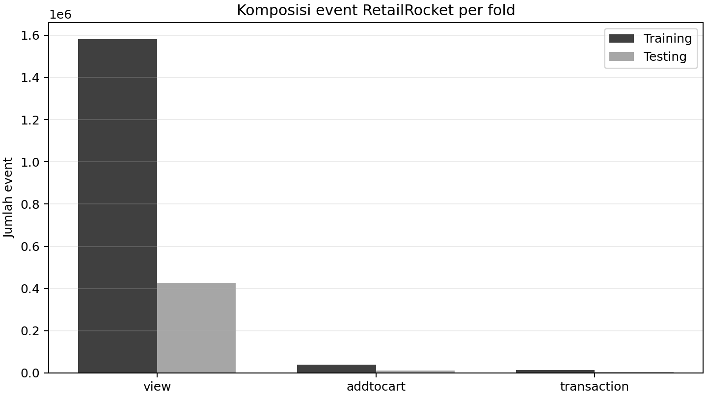
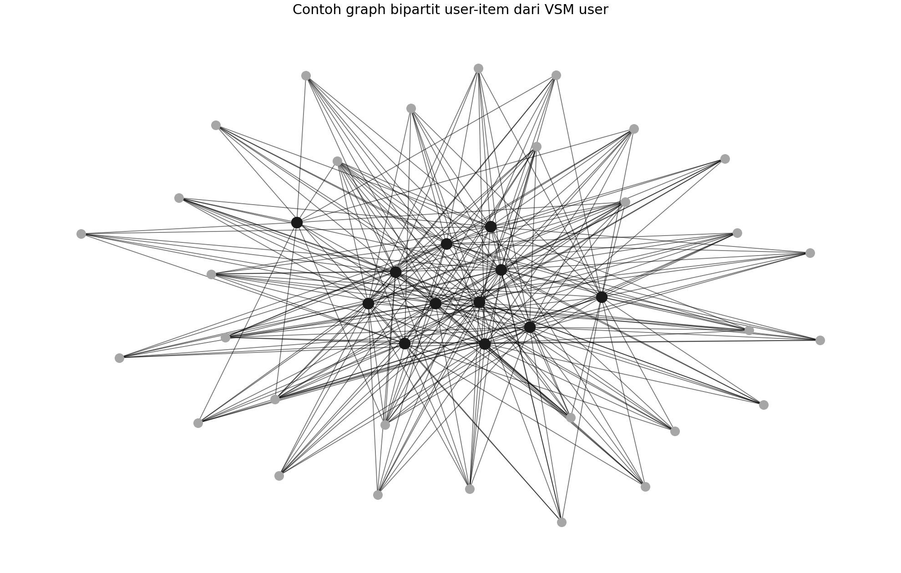
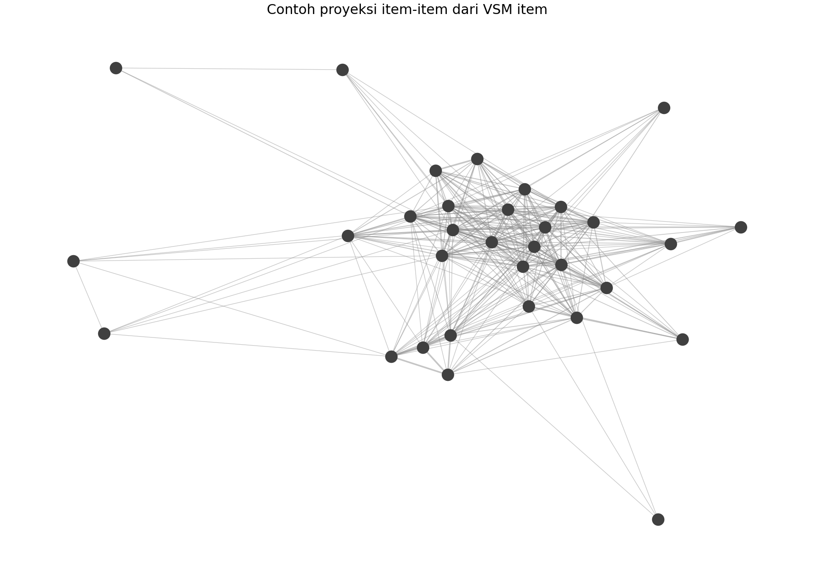
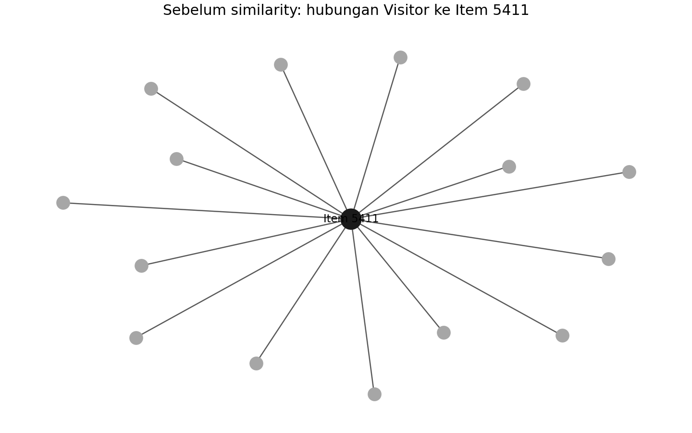
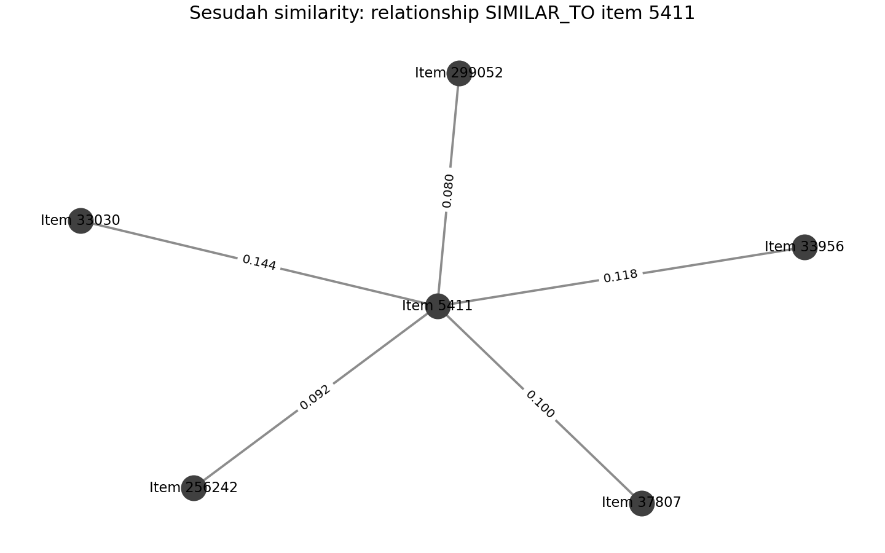

# UTS Graf Sains Data

**Nama:** Kristian Bintang Marnaek Hutapea
**NIM:** 23031554004
**Kelas:** GSD 2023E

## Ringkasan proyek

Proyek ini mengolah data interaksi e-commerce RetailRocket menjadi graph bipartit `Visitor` dan `Item`. Tahap analisis meliputi pembagian data temporal, Exploratory Data Analysis, Vector Space Model, proyeksi graph, cosine similarity item, rekomendasi K-Nearest Neighbors, serta evaluasi Hit@5 dan NDCG@5.

Dataset asal adalah [RetailRocket E-commerce Dataset di Kaggle](https://www.kaggle.com/datasets/retailrocket/ecommerce-dataset). Kolom yang digunakan adalah `timestamp`, `visitorid`, `event`, `itemid`, dan `transactionid`.

## Pembagian data

Pembagian data mengikuti NIM 23031554004. Timestamp Unix epoch milliseconds dikonversi ke UTC. Batas akhir dibuat eksklusif supaya sebuah event tidak mungkin muncul pada dua fold.


| Fold     | Rentang waktu UTC                   | Jumlah event | Jumlah visitor | Jumlah item |
| -------- | ----------------------------------- | -----------: | -------------: | ----------: |
| Training | 01 Mei 2015 sampai 20 Juli 2015     |    1.635.266 |        830.707 |     187.985 |
| Testing  | 21 Juli 2015 sampai 10 Agustus 2015 |      441.425 |        243.247 |      98.648 |

Dataset baru dimulai pada 03 Mei 2015, sehingga dua hari pertama pada rentang training tidak memiliki event.

## 2.1 Wrangling dan EDA

### 1. Filter timestamp dan file CSV

Script menyimpan hasil filter ke:

- `output/events_training_2015-05-01_2015-07-20.csv`
- `output/events_testing_2015-07-21_2015-08-10.csv`

Kedua CSV berukuran besar sehingga tidak dimasukkan ke GitHub. File akan dibuat ulang ketika script dijalankan.

### 2. Komposisi subgraph

Graph memiliki dua tipe simpul:


| Tipe simpul |  Jumlah |
| ----------- | ------: |
| `Visitor`   | 830.707 |
| `Item`      | 187.985 |

Hubungan graph berasal dari jenis event berikut:


| Relationship Neo4j | Event asal    |  Training | Testing |
| ------------------ | ------------- | --------: | ------: |
| `VIEWED`           | `view`        | 1.581.970 | 426.232 |
| `ADDED_TO_CART`    | `addtocart`   |    40.125 |  11.522 |
| `BOUGHT`           | `transaction` |    13.171 |   3.671 |



Cypher untuk melihat komposisi simpul:

```cypher
MATCH (n)
RETURN labels(n) AS node_type, count(n) AS jumlah_node
ORDER BY jumlah_node DESC;
```

Cypher untuk melihat komposisi relationship:

```cypher
MATCH ()-[r]->()
RETURN type(r) AS relationship_type, count(r) AS jumlah_relationship
ORDER BY jumlah_relationship DESC;
```

### 3. VSM user

Vector Space Model atau VSM user direpresentasikan sebagai matriks user-item. Setiap baris adalah visitor, setiap kolom adalah item, dan nilainya merupakan bobot interaksi:


| Event         | Bobot |
| ------------- | ----: |
| `view`        |     1 |
| `addtocart`   |     3 |
| `transaction` |     5 |

Karakteristik VSM user:

- Shape: **830.707 × 187.985**
- Pasangan user-item tidak nol: **1.266.049**
- Density: **0,000008107**
- Rata-rata item per user: **1,52**
- Median item per user: **1**
- Maksimum item per user: **1.937**

Graph penuh terlalu besar untuk diplot. Visual di bawah adalah subgraph sampel dari user paling aktif dan item yang terhubung dengannya. Titik hitam adalah user, titik abu-abu adalah item.



### 4. VSM item

VSM item adalah transpose dari VSM user. Setiap baris adalah item dan setiap kolom adalah visitor.

- Shape: **187.985 × 830.707**
- Rata-rata user per item: **6,73**
- Median user per item: **2**
- Maksimum user per item: **1.593**

Berikut contoh proyeksi item-item. Dua item terhubung apabila ada user yang berinteraksi dengan keduanya. Item tanpa hubungan pada sampel tidak ditampilkan.



### 5. Pemilihan proyeksi yang lebih efisien

Proyeksi item dipilih karena jumlah kandidat edge-nya lebih kecil.


| Proyeksi  | Estimasi kandidat edge |
| --------- | ---------------------: |
| User-user |             34.749.684 |
| Item-item |             16.149.176 |

Selain itu, jumlah item lebih kecil daripada jumlah user. Karena itu, proyeksi item lebih hemat komputasi untuk menghitung similarity.

### 6. Similarity item

Cosine similarity dihitung pada VSM item. Item acuan adalah item yang paling sering muncul pada training, yaitu `5411`.


| Peringkat | Item mirip | Cosine similarity |
| --------: | ---------: | ----------------: |
|         1 |      33030 |        0,14443843 |
|         2 |      33956 |        0,11763925 |
|         3 |      37807 |        0,10010426 |
|         4 |     256242 |        0,09232622 |
|         5 |     299052 |        0,07992012 |

File hasil: `output/top5_item_similarity.csv`.

Cypher untuk menampilkan lima item mirip setelah relationship similarity ditulis:

```cypher
MATCH (source:Item {itemId: 5411})-[s:SIMILAR_TO]->(candidate:Item)
RETURN source.itemId AS item_acuan,
       candidate.itemId AS item_mirip,
       s.score AS cosine_similarity
ORDER BY s.score DESC
LIMIT 5;
```

### 7. Graph sebelum dan sesudah similarity

Sebelum similarity, graph hanya memiliki hubungan perilaku visitor ke item:

```cypher
MATCH (v:Visitor)-[r:VIEWED|ADDED_TO_CART|BOUGHT]->(i:Item)
RETURN v, r, i
LIMIT 100;
```

Sesudah similarity, item acuan memiliki hubungan `SIMILAR_TO` ke item lain:

```cypher
MATCH (source:Item {itemId: 5411})-[s:SIMILAR_TO]->(candidate:Item)
RETURN source, s, candidate
LIMIT 5;
```

Query untuk menyimpan similarity tersedia di [neo4j_uts_queries.cypher](neo4j_uts_queries.cypher).

Visualisasi berikut menggambarkan pola relationship yang sama dengan query Neo4j. Gambar pertama menunjukkan event perilaku sebelum similarity dan gambar kedua menunjukkan relationship item-item setelah `SIMILAR_TO` ditambahkan.





## 2.2 Analytics

### 1. Rekomendasi KNN

User dipilih secara acak namun hasilnya tetap bisa diulang menggunakan `np.random.default_rng(23031554004)`. User terpilih adalah `506200` dan menggunakan **k = 5** neighbor.


| Neighbor user | Cosine similarity |
| ------------: | ----------------: |
|        764475 |        0,57735026 |
|       1342290 |        0,49236596 |
|        831799 |        0,43245083 |
|        408723 |        0,40824828 |
|         74145 |        0,40824828 |

Tiga item untuk diiklankan:

1. Item `171143`
2. Item `189288`
3. Item `151586`

Lima rekomendasi lengkap tersedia pada `output/top5_recommendations.csv`.

### 2. Hit@5 dan NDCG@5

Item relevan adalah item testing yang belum pernah dilihat visitor 506200 pada training: `81104`, `84810`, `133071`, `178274`, `361551`, dan `396671`.


| Metrik | Nilai |
| ------ | ----: |
| Hit@5  |   0,0 |
| NDCG@5 |   0,0 |

Tidak ada item relevan yang muncul pada Top-5 rekomendasi. Hasil nol tetap valid karena evaluasi dilakukan secara temporal dan data ini sangat sparse. Artinya baseline KNN ini masih dapat dikembangkan dengan pembobotan waktu, nilai `k` lain, atau model rekomendasi lain.
